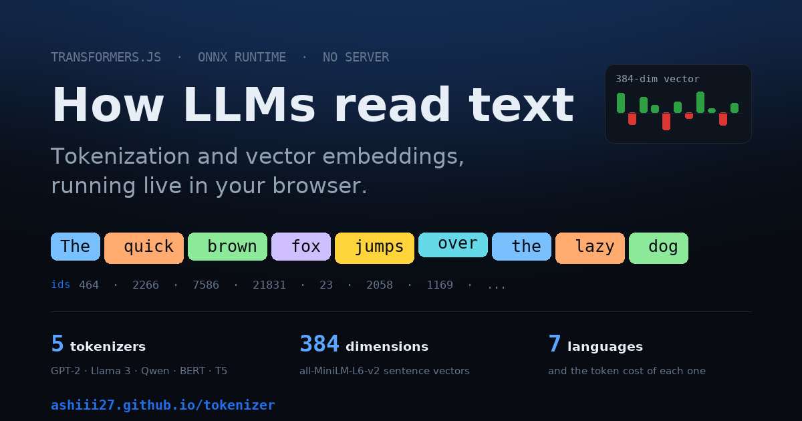

# How LLMs read text

**Tokenization and vector embeddings, running live in your browser.**

[](https://github.com/Ashiii27/tokenizer/actions/workflows/ci.yml)
[](https://github.com/Ashiii27/tokenizer/actions/workflows/deploy.yml)
[](LICENSE)

**[→ Open the live demo](https://ashiii27.github.io/tokenizer/)**



An interactive explainer for the two steps every language model performs before any "thinking"
happens: **text → token IDs**, and **text → meaning vectors**. No server, no API keys, no setup — a
real GPT-2 tokenizer and a real sentence-embedding model are downloaded once and then run on your
own machine through WebAssembly or WebGPU. Whatever you paste never leaves your browser.

---

## What you can do with it

| Section | What it shows |
|---|---|
| **1 · Tokens** | Type anything and see the real GPT-2 tokens, their IDs, their byte counts, and how each token maps back to your text. Includes a context-window meter. |
| **2 · Tokenizers** | The same sentence through GPT-2, Llama 3, Qwen2.5, BERT and T5 side by side, with the token-count multiplier between the cheapest and most expensive. |
| **3 · Languages** | One sentence in seven languages — English, Hindi, Bengali, Tamil, Chinese, Japanese, Arabic — and what each one costs in tokens. |
| **4 · Embeddings** | Cosine similarity between two texts, the arithmetic spelled out, and the twelve dimensions that actually drive the score. |
| **5 · Corpus** | Paste up to 40 sentences: an n×n similarity matrix plus every item's nearest neighbours. Retrieval, in one screen. |
| **6 · Meaning map** | The same corpus projected from 384 dimensions to 2 with PCA — semantically similar sentences land near each other. |

### Five things it will tell you that most explainers don't

1. **Non-Latin text is expensive.** `कृत्रिम बुद्धिमत्ता` needs several tokens per character in an
   English-centric vocabulary. Same meaning, several times the context budget and the bill.
2. **Chips rejoin into your exact text** — including Devanagari, Han characters and 4-byte emoji.
   (This is harder than it looks: see [Why the tokenizer code is the way it is](#why-the-tokenizer-code-is-the-way-it-is).)
3. **Whitespace is a token.** A leading space is part of the token, so `dog` and ` dog` are different
   IDs. The UI draws spaces as `·` and newlines as `⏎` so they can't hide.
4. **Antonyms and homonyms score high.** `hot`/`cold` sit close together; `bank`(river) and
   `bank`(money) share a vector. A single vector cannot distinguish them.
5. **Embedding similarity is model-relative.** Scores are only comparable inside one model; the page
   says so, and warns when a text exceeds the 512-token window that MiniLM silently truncates.

---

## Stack

| Piece | Choice | Why |
|---|---|---|
| Inference | [Transformers.js](https://github.com/huggingface/transformers.js) v4 | Runs ONNX models in the browser; no Python, no server |
| Runtime | ONNX Runtime Web — WebGPU with WASM fallback | GPU when available, works everywhere else |
| Tokenizer | `Xenova/gpt2` (+ Llama 3 / Qwen2.5 / BERT / T5) | Tokenizer files only — a few hundred KB each |
| Embeddings | `Xenova/all-MiniLM-L6-v2` (384-dim) | 23 MB quantised; the standard small sentence encoder |
| Build | **None** | Plain ES modules + CSS. `git clone`, serve, done |
| Tests | Node's built-in runner + jsdom | 55 tests, zero config (`npm test`) |

The only runtime dependencies are fetched from jsDelivr and the Hugging Face Hub on first use, then
served from Cache Storage.

---

## Run it locally

Any static file server works. ES modules and Web Workers do **not** run from `file://`:

```bash
git clone https://github.com/Ashiii27/tokenizer.git
cd tokenizer
python3 -m http.server 8080
# open http://localhost:8080
```

Then, optionally:

```bash
npm install     # jsdom, for the DOM integration test
npm test        # 55 tests
```

---

## How it works

```
index.html ──► src/main.js ──┬─► demos/tokenize-panel.js   ─┐
                             ├─► demos/compare-panel.js     │
                             ├─► demos/languages-panel.js   ├─ RPC over postMessage
                             ├─► demos/embed-panel.js       │   {id, op, payload}
                             ├─► demos/corpus-panel.js      │
                             └─► demos/map-panel.js        ─┘
                                                             │
                                          src/lib/client.js ─┴─► model-worker.js
                                                                   │
                                        Transformers.js (CDN) ─────┤
                                        Hugging Face Hub ──────────┴─► Cache Storage
```

- **Everything heavy runs in a Web Worker** (`src/lib/model-worker.js`), so a 23 MB download or a
  long tokenisation never freezes the page — or the loading animation telling you it's working.
- **Pure logic lives in dependency-free modules** (`tokens.js`, `similarity.js`, `pca.js`,
  `format.js`) and is unit-tested without a browser or a model.
- **Models load on demand**: the 1 MB tokenizer immediately, the 23 MB embedder only when a panel
  that needs it becomes visible (and never under `Data Saver`).
- **Two library generations are supported**, so a CDN or API change can't take the page down.

### Why the tokenizer code is the way it is

GPT-2 and friends are **byte-level BPE**. A character like `न` is three UTF-8 bytes and is routinely
split across two or three tokens. Decoding one token in isolation gives a truncated byte sequence and
therefore ``, so the obvious implementation renders your Hindi, Chinese and emoji input as rows of
replacement characters — while telling you the chips reconstruct your text.

The fix in [`src/lib/tokens.js`](src/lib/tokens.js): decode *growing prefixes*, strip the incomplete
tail, record where each token's text begins, then slice the final string with those offsets. Every
chip is a contiguous slice of one string, so concatenation is exact by construction — in any script.
It's also the one thing in this repo with the most tests.

---

## Repository layout

```
index.html               structure only — no inline CSS, no inline JS
styles/tokens.css        design tokens: colour, type, spacing, both themes
styles/base.css          reset, page chrome, panels
styles/components.css    chips, meters, tables, matrix, canvas
src/main.js              wiring: theme, nav, model lifecycle
src/lib/model-worker.js  all inference, off the main thread
src/lib/client.js        promise RPC + model state
src/lib/tokens.js        token boundaries, whitespace, stats        ← tested
src/lib/similarity.js    cosine, contributions, kNN, matrix          ← tested
src/lib/pca.js           384d → 2d projection                        ← tested
src/lib/chips.js         token chip rendering, roving tabindex
src/lib/{dom,format,progress,store,theme,urlstate,models}.js
src/demos/*.js           one module per panel
tests/                   55 tests: unit, structure, DOM integration
scripts/make-og.py       regenerates assets/og.png
```

## Features that are easy to miss

- **Shareable URLs** — every input is in the query string (`?t=…&a=…&b=…&c=…`), so a link
  reproduces exactly what someone was looking at. Inputs also persist in `localStorage`.
- **Keyboard** — `⌘/Ctrl + Enter` runs any panel; token chips are a single tab stop with arrow-key
  navigation; the map responds to arrow keys.
- **Light + dark themes**, following `prefers-color-scheme` until you choose one.
- **Accessible by construction**: skip link, landmarks, live regions for results, visible focus,
  `prefers-reduced-motion` support, WCAG-AA contrast.

---

## Deploying

`.github/workflows/deploy.yml` publishes the repository root to GitHub Pages on every push to
`main` (no build step). Enable **Settings → Pages → Source: GitHub Actions** once.

`.github/workflows/ci.yml` runs on every pull request: unit + structure + DOM tests, a check that
every asset the page references exists, and a Lighthouse budget on the shell.

## Roadmap

`IMPROVEMENTS.md` is a code-level review of the original two-panel version plus the plan this repo
followed. Deliberately not built yet:

- **Next-token probabilities** from a small causal LM (closes the loop tokens → vectors → prediction;
  needs a ~100 MB model, so it deserves its own opt-in panel).
- **Build-a-tokenizer**: train a BPE vocabulary in the browser and diff it against GPT-2.
- **Layer-wise similarity**: how two sentences converge through the transformer stack.
- Cross-model embedding comparison (`bge-small`, `multilingual-e5`).

## Credit

Built on [Transformers.js](https://github.com/huggingface/transformers.js) by Joshua Lochner and the
Hugging Face team, [ONNX Runtime Web](https://onnxruntime.ai/), and models hosted on the
[HF Hub](https://huggingface.co/Xenova). Text and code: MIT.
